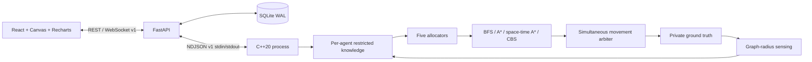

# Implementation architecture

## Boundaries

Ground truth is private to `Simulation`. The graph algorithms and allocation interfaces accept `Grid`, `Knowledge`, delivered `Report`, and `Candidate` data; they do not accept the environment. Public station coordinates are permitted configuration. No browser computation controls the engine.

The evaluator computes coverage and hashes from truth. The dashboard can display evaluator truth but cannot submit it as an agent observation. Custom editing creates a different scenario.

## Engine tick

Faults → due messages → sensing → merge/frontiers → suspicion → energy modes → allocation → space-time paths → movement validation → accounting/charging → outgoing reports → metrics/termination.

Observation merge orders `(tick, source ID)` lexicographically. Old data cannot overwrite newer observations. Unknown is never a replacement for known information. Messages have stable delivery keys and bounded queues.

The communication medium models direct range-limited links, delay, drops, and explicit two-group partitions. It does not currently model multi-hop packet routing. Agents exchange bounded observation batches, report their state to the virtual base, and acknowledge delivered reports. Synchronization is eventual when links, energy, and sufficient delivery time permit it.

## Allocation

- Independent: nearest feasible local frontier; ignores claims.
- Greedy: sorted feasible agent/frontier pairs from delivered coordinator knowledge.
- Hungarian: custom rectangular primal-dual matching with idle columns and forbidden costs.
- Decentralized: delivered peer bids, score/ID tie-breaking, expiring claims, and claim conflict recovery.
- Adaptive: delivered-state Hungarian matching when the coordinator handshake is fresh; local peer auctions during coordinator loss; score threshold and commitment hold reduce switching.

Centralized offers use offer → acknowledgment → commit messages and expire if the exchange exceeds three ticks. A missed deadline triggers a coordinator cooldown: adaptive agents use peer auctions, and centralized distance baselines use their documented local fallback. Heartbeat freshness alone cannot imply a usable assignment handshake. Coordinator feature inputs come from delivered reports, rather than live hidden agent state.

Acknowledged coordinator claims reserve tasks until release or lease expiry; a delayed report cannot silently free a new acknowledgment. Frontier-component merges reconcile these claims in acknowledgment-time/agent-ID order and issue delivered revocations. Known unavailable peers are excluded. Visible orphan work triggers reconsideration between ordinary five-tick allocation epochs. Tests verify unique agents and components within the acknowledged domain.

Adaptive weights use integer score units. Defaults match the PRD and can be supplied in `config.adaptiveWeights`. Set an individual factor to zero for an ablation; freeze weights in each experiment manifest.

The environment remains partially observed. Shortest-path or matching optimality does not imply mission optimality. Distributed claims can overlap across partitions.

## Planning and safety

Spatial A* uses Manhattan distance on a unit-cost four-neighbor graph. BFS uses a FIFO queue and is available as the spatial comparison. Space-time A* allows waits, rejects reserved vertices and reverse edges, and uses a reverse BFS distance field on the known graph as its admissible heuristic. Its rolling prefix minimizes remaining known-route distance at the horizon, including detours that initially move away from the goal. After prolonged blocking, agents release work, try a known feasible adjacent staging cell, and can send a yield request to a locally observed blocking peer. Unsuccessful staging is bounded and retried; it is not a proof of liveness.

The reservation layer and final arbiter are simulator safety mechanisms. They are not a claim of physically decentralized collision prevention. Failed agents remain occupied obstacles. A rejected move can force a chain of other moves to become waits; the arbiter resolves that cascade before simultaneous commitment.

CBS uses a constraint-tree min-heap and constrained low-level A*. It checks goal occupancy, vertex conflicts, and swaps. A simulated `joint_prepare` message reaches each participating agent before it freezes and transmits its own planning map and goal. Agents without a delivered preparation continue local reservation planning. The coordinator sends proposed routes, receives acknowledgments, and sends a future execution tick. Each agent validates against its own knowledge before acknowledging and while executing. Lost messages, envelope/budget exhaustion, and invalidated routes produce named reservation fallbacks. Limits match the PRD: 5,000 high-level nodes, 100,000 expansions per low-level replan, 32 × 32 cells, eight agents, and a horizon bounded by the remaining run ticks. Constraint traces retain up to 512 entries per solve and record truncation explicitly. Tiny-instance studies compare sum of costs with an exhaustive joint-state Dijkstra oracle; they do not imply optimal exploration.

## Persistence and lifecycle

SQLite runs in WAL mode with foreign keys. Tick zero, every 50 ticks, and terminal ticks store zlib-compressed full checkpoints. Other ticks store lossless structural deltas in the same transaction as events, metrics, and agent summaries. A replay seek reconstructs from the nearest checkpoint through at most 49 deltas and checks the stored chain references. Older full-snapshot databases remain readable. Separate indexed metric and agent summaries keep chart queries bounded to 1,000 samples; terminal state and metric summaries commit atomically.

Snapshots support replay, not restoration of the engine's pending message queues. After a backend restart, active runs become failed/interrupted; they remain inspectable. A reset creates a new run identity and reuses the frozen initial scenario.

WebSocket messages carry version, run ID, logical tick and sequence. An initial full snapshot is followed by structural deltas referencing the last sequence actually sent to that client. Coalescing computes the next delta against that client's base, with a contiguous per-connection sequence. The React decoder preserves immutable state and requests a new snapshot/reconnects if a base or sequence is missing. Display updates are capped at ten per second; persisted events and ticks remain complete even when display states are coalesced.

Engine commands return a correlated NDJSON response containing state and an ordered event batch; terminal advances use the `terminal` response type. An advance contains at most ten ticks and retains separate timing measurements for every advanced tick. Interactive mode advances one tick and persists each state. The headless runner batches up to ten ticks to reduce serialization overhead while retaining every event and timing sample. The backend never substitutes Python allocation or pathfinding after an engine error.

## Resource and experiment behavior

Charging requests are FIFO by arrival tick and ID. An idle station occupant moves to a known adjacent staging cell for a waiting peer, including when its battery is only partially full. Admission includes known return travel, reserve, and a conservative team queue estimate. Charging communication is limited to one quarter of the charging rate, preserving positive net recharge. Optional sends and receives protect the current return budget. These estimates cannot protect against an unforeseen route closure.

Charging eligibility at the sensing boundary prevents a service tick from also charging sensing or movement. Each agent exposes consumed costs by category and charging received, so its initial energy plus gain minus costs reconciles exactly. Movement-productivity events classify the following actual sensing cycle; any move without that observation remains explicitly unclassified. By-type message and byte counters reconcile with the communication log. Recovery exports censor an aggregate when any applicable episode remains unresolved; missing or inapplicable work is not zero.

Generated room/corridor maps use version `rooms-2`, with deterministic bounded placement and connected growth to the requested interior free-cell count. Targets, starts, stations, and automatic fault schedules are materialized into frozen manifests. One interactive process or one sequential batch runs at a time. Completed results are retained when a batch is cancelled or an engine fails. Exports stream from a bounded-memory spool and include manifests, binary hashes, compiler/build metadata, raw events, units, censoring status, and statistical summaries. Timing runs must be sequential and isolated from other workloads to support performance claims.

## Complexity

| Operation | Complexity |
|---|---|
| BFS / frontier extraction | O(V + E) |
| Heap-based A* | O((V + E) log V) |
| Multi-source station distance field | O(V + E), cached by knowledge revision |
| Greedy matching after cost construction | O(AF log(AF)) |
| Rectangular Hungarian | O(A²(F + A)), bounded by O(n³) |
| Space-time A* | O(H(V + E) log(VH)) |
| Event queue insertion/removal | O(log M) |
| CBS | Potentially exponential; explicit high/low expansion caps |

Search counters, CBS nodes, prevented conflicts, assignment churn, byte counts, and wall-clock tick time are emitted by the engine. Wall-clock time is excluded from deterministic state hashes.

## Deliberate operational limits

- One interactive simulation or one sequential experiment batch at a time.
- 16–128 grid dimensions and up to 16 agents are the standard intended envelope; larger values are experimental.
- No user accounts, external services, cloud hosting, hardware, or machine learning.
- No deadlock-freedom or adversarial completion guarantee.
- Benchmark run results, not policy names, determine performance conclusions.
