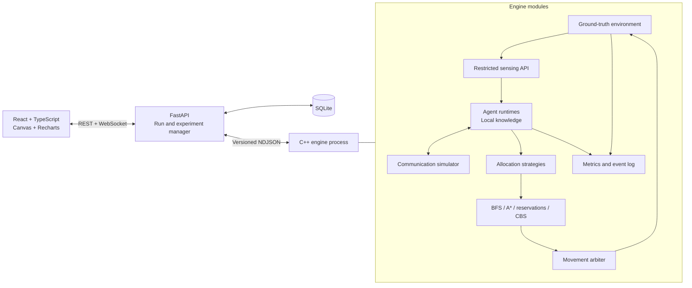
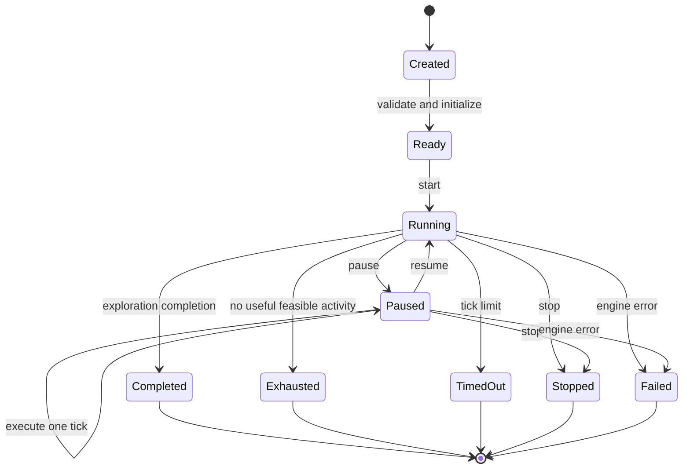
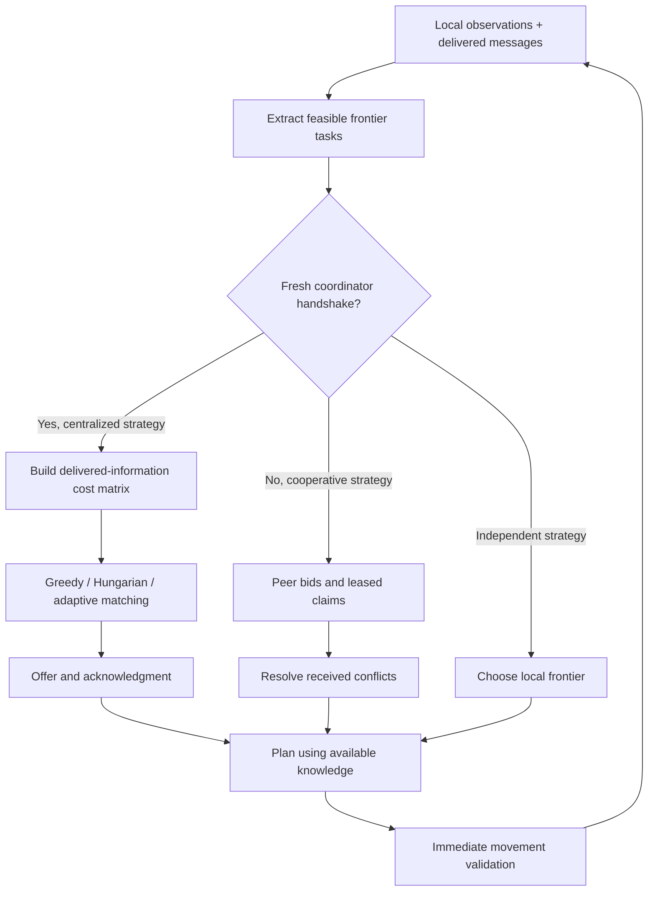
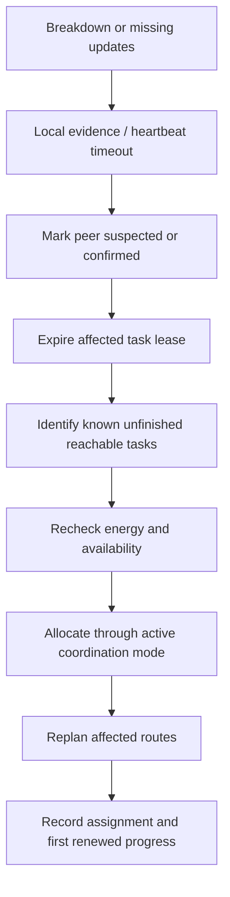

# CONFLUENCE — Adaptive Multi-Agent Intelligence System
## Product Requirements Document

**Tagline:** Many agents. One mission.  
**Category:** Data Structures and Algorithms / Multi-Agent Systems / Intelligent Simulation  
**Document status:** Implementation specification; features and performance are not yet validated  
**Delivery:** Complete software product specification, without a weekly development schedule  
**Team:** 3–4 computer engineering students

---

## 1. Executive Summary

CONFLUENCE is a deterministic, software-only simulation platform for studying how autonomous agents explore unknown environments, exchange discoveries, allocate work, avoid collisions, manage energy, and recover from disruptions.

Its central artifact is a C++ algorithm engine. A Python backend manages runs and persistence, while a React dashboard exposes the engine’s behavior and experimental results.

The complete product includes:

- Procedural and custom grid environments.
- Separate knowledge maps for every agent.
- Frontier-based exploration.
- Five allocation strategies: independent, greedy, Hungarian, decentralized auction, and adaptive hybrid.
- BFS, A*, reservation-based movement planning, and bounded CBS.
- Delayed and unreliable communication.
- Agent failures, dynamic obstacles, charging, and task recovery.
- Reproducible comparisons, analytics, exports, and replay.

The proposed technical contribution is **Adaptive Cooperative Allocation**, a resource-aware hybrid policy that adjusts allocation decisions using energy, reliability, information freshness, task value, workload, and reassignment cost. It is a proposed engineering contribution, not a claim of a novel or superior algorithm.

### Feasibility and trade-off decisions

| Issue | Product decision |
|---|---|
| Too many independent subsystems | Use one C++ engine, one FastAPI service, one SQLite database, and one frontend. |
| Unknown maps versus simulator omniscience | Ground truth belongs exclusively to environment execution and evaluation. Agents and allocators receive restricted observations. |
| Decentralization versus centralized Hungarian allocation | Provide separate coordination modes and identify the information each mode can access. |
| Network partitions versus unique assignments | Uniqueness is enforced within an acknowledged allocation domain. Duplicate claims across disconnected domains are possible and measured. |
| Collision safety during communication loss | A simulator movement arbiter validates immediate actions. This is an explicit simulation mechanism, not evidence of fully decentralized physical safety. |
| CBS computational cost | Implement CBS for small supported instances with deterministic search limits and an explicit fallback. |
| Energy safety in changing environments | Require feasible return routes under current knowledge. Unexpected blockages can still strand agents. |
| Algorithm optimality | State guarantees only for the corresponding mathematical subproblem. |
| Complete product versus staged implementation | Specify the complete product, but retain dependency-based P0/P1/P2 priorities without a calendar. |

---

## 2. Project Vision

Make collective exploration observable, explainable, and experimentally testable.

A user should be able to create one scenario, run different coordination strategies against it, inspect individual decisions, inject disruptions, and compare measured outcomes.

The project should demonstrate DSA through functioning implementations and evidence:

- Graph traversal and shortest paths.
- Connected-component extraction.
- Bipartite assignment.
- Distributed auction messages and leases.
- Space-time reservations.
- Constraint-tree search.
- Priority-queue event processing.
- Versioned map synchronization.
- Deterministic simulation and statistical evaluation.

Frontier exploration follows the established idea of navigating toward boundaries between known free space and unexplored space. CONFLUENCE adapts this concept to a discrete software environment. [Yamauchi, 1997](https://www.cs.cmu.edu/~motionplanning/papers/sbp_papers/integrated1/yamauchi_frontiers.pdf)

---

## 3. Problem Statement

Independent agents can repeatedly explore the same space, compete for corridors, waste energy, and abandon useful work when failures occur.

Centralized coordination can reduce duplication but depends on timely information. Decentralized coordination tolerates disconnection but may produce inconsistent assignments.

CONFLUENCE investigates this question:

> How can a team of agents maintain useful exploration progress while balancing information gain, travel, energy, communication, assignment stability, and recovery?

The system must expose these trade-offs rather than assuming perfect communication, complete maps, or guaranteed completion.

Task allocation is treated as repeated assignment of single-agent exploration tasks, consistent with established task-allocation classifications. [Gerkey and Matarić, 2004](https://www.robotics.stanford.edu/~gerkey/research/mrta.html)

---

## 4. Objectives

| ID | Objective | Evidence |
|---|---|---|
| OBJ-01 | Explore using progressively acquired knowledge | Per-agent observation and map logs |
| OBJ-02 | Coordinate without hidden ground-truth access | Restricted engine interfaces and isolation tests |
| OBJ-03 | Implement five genuine allocation strategies | Strategy implementations and decision traces |
| OBJ-04 | Prevent committed vertex and edge-swap collisions | Movement invariant checks |
| OBJ-05 | Adapt to communication and operational failures | Fault scenario results |
| OBJ-06 | Account for energy explicitly | Per-action energy ledger |
| OBJ-07 | Compare strategies reproducibly | Paired seeded experiments |
| OBJ-08 | Explain decisions | Scores, assignments, paths, conflicts, and reasons |
| OBJ-09 | Demonstrate substantial DSA implementation | Source code, pseudocode, tests, and complexity documentation |

Improved performance is a research hypothesis. Product acceptance does not require the adaptive policy to outperform every baseline.

---

## 5. Target Users and Use Cases

| User | Use case |
|---|---|
| Student developer | Implement and validate algorithms through a shared engine interface |
| Competition evaluator | Inspect algorithm behavior and reproduce claims |
| Instructor | Demonstrate graph search, assignment, coordination, and complexity |
| Experimenter | Compare strategies under controlled disruptions |
| Demonstration operator | Configure a scenario and explain failures interactively |

Primary journeys:

1. Generate a seeded map, select a strategy, and run exploration.
2. Select an agent and inspect its knowledge, task, energy, and decisions.
3. Inject a failure and observe detection, reassignment, and recovery.
4. Compare all five strategies using the same scenario manifest.
5. Save, replay, and export experiment results.

---

## 6. Scope and Out-of-Scope Items

### Complete product scope

- Two-dimensional, four-neighbor grid worlds.
- Discrete simulation ticks.
- Homogeneous agents with configurable initial energy and locations.
- Static walls, rooms, corridors, targets, zones, charging stations, and scheduled obstacle changes.
- Five allocation strategies and two multi-agent planning modes.
- Communication simulation, recovery, analytics, persistence, and replay.

### Supported operating envelopes

| Mode | Envelope |
|---|---|
| Default demonstration | 64 × 64 grid, 4 agents |
| Standard supported range | 16 × 16 to 128 × 128, 1–16 agents |
| CBS demonstration | At most 32 × 32, 8 agents, distinct goals |
| Experimental stress mode | Up to 256 × 256 and 32 agents; no responsiveness guarantee |

The UI must label experimental configurations.

### Out of scope

Physical devices, hardware integration, continuous motion physics, SLAM, learned policies, language models, paid APIs, cloud microservices, production multi-user authentication, and guaranteed optimal exploration.

Hidden targets are discovered through sensing. They do not require physical collection or transport.

---

## 7. Functional Requirements

**Priority:** P0 = foundation, P1 = complete competition product, P2 = extension.  
All P0 and P1 requirements belong to the requested complete product.

| ID | Requirement | Priority | Acceptance criteria | Dependencies |
|---|---|---:|---|---|
| FR-001 | Generate reproducible environments | P0 | Same generator version, parameters, and seed produce identical map hashes | — |
| FR-002 | Validate and edit custom maps | P1 | Reject overlapping starts, invalid cells, and unsupported dimensions; disconnected maps require explicit confirmation | FR-001 |
| FR-003 | Initialize configurable agents | P0 | Unique IDs, valid distinct starts, initial local observations, and energy are created | FR-001 |
| FR-004 | Maintain separate agent knowledge | P0 | An undiscovered obstacle cannot affect an agent’s allocation score or route | FR-003 |
| FR-005 | Sense the environment progressively | P0 | Only cells allowed by the sensor model enter local knowledge | FR-004 |
| FR-006 | Extract frontier tasks | P0 | Every frontier representative is known free and adjacent to unknown space | FR-005 |
| FR-007 | Implement BFS and A* | P0 | Both return shortest paths on supported static unit-cost maps | FR-004 |
| FR-008 | Implement independent allocation | P0 | Each agent chooses from local knowledge without consulting assignments | FR-006, FR-007 |
| FR-009 | Implement greedy allocation | P0 | Delivered eligible agents and tasks produce deterministic nonduplicate assignments | FR-006, FR-007 |
| FR-010 | Implement Hungarian allocation | P1 | Small matrices match exhaustive optimal assignment results | FR-009 |
| FR-011 | Implement decentralized auctions | P1 | Bids, claims, expiry, conflicts, and reconciliation appear in message logs | FR-006, FR-015 |
| FR-012 | Implement adaptive hybrid allocation | P1 | Logged scores include all specified factors and switching decisions | FR-010, FR-011, FR-019 |
| FR-013 | Prevent movement conflicts | P0 | No committed vertex collision or edge swap occurs | FR-007 |
| FR-014 | Implement CBS mode | P1 | Solve supported small cases or report budget exhaustion and named fallback | FR-013 |
| FR-015 | Simulate communication | P1 | Delay, drops, partitions, delivery, and byte costs follow scenario configuration | FR-003 |
| FR-016 | Synchronize discoveries after reconnection | P1 | Delivered records converge using deterministic observation ordering | FR-015 |
| FR-017 | Inject agent and environment failures | P1 | Scheduled failures occur at specified ticks and produce events | FR-003 |
| FR-018 | Detect and recover unfinished work | P1 | Suspicions, lease expiry, reassignment, and actual progress are separately recorded | FR-011, FR-017 |
| FR-019 | Model energy and charging | P1 | Every action has an auditable cost; energy remains within valid bounds | FR-003, FR-007 |
| FR-020 | Discover hidden targets | P0 | Target discovery occurs only when a sensor observes its cell | FR-005 |
| FR-021 | Control simulation lifecycle | P0 | Start, pause, resume, step, stop, reset, and speed behave consistently | FR-003 |
| FR-022 | Compare algorithms fairly | P1 | Strategies share frozen scenario, fault, and parameter manifests | FR-008–FR-019 |
| FR-023 | Calculate live and final metrics | P1 | Metrics reconcile with exported events and counters | FR-021 |
| FR-024 | Persist scenarios and results | P1 | Application restart preserves committed scenarios, runs, events, and results | FR-021 |
| FR-025 | Replay saved runs | P1 | Replay reproduces recorded states and supports seeking between checkpoints | FR-024 |
| FR-026 | Inspect individual agents | P0 | Selected agent view includes local map, task, path, energy, and decision history | FR-004 |
| FR-027 | Export experiments | P1 | Export contains JSON manifest, CSV metrics, event log, versions, and hashes | FR-022–FR-024 |
| FR-028 | Handle terminal conditions | P0 | Completion, exhaustion, timeout, all-unavailable, and engine error are distinct | FR-021 |
| FR-029 | Execute headless batches | P1 | Batch runner completes experiments without a browser and supports cancellation between runs | FR-022, FR-024 |
| FR-030 | Explain algorithm operations | P1 | Show expansions, bids, assignment scores, CBS constraints, and fallback reasons | FR-007–FR-014 |

---

## 8. Non-Functional Requirements

All performance numbers below are **unvalidated engineering goals**, measured on a declared reference machine with at least four CPU cores and 8 GB RAM.

| ID | Category | Requirement and acceptance |
|---|---|---|
| NFR-001 | Performance | Default scenario targets 20 simulation ticks/second, with non-CBS engine tick p95 below 50 ms |
| NFR-002 | Responsiveness | Controls acknowledge within 250 ms when the backend is healthy; planning work must not block the UI thread |
| NFR-003 | Rendering | Default grid targets at least 30 rendered frames/second; rendering rate remains independent of simulation speed |
| NFR-004 | Scalability | Standard envelope completes bounded runs without unbounded queue or memory growth |
| NFR-005 | Reproducibility | Same manifest and engine build yield identical canonical state hashes, excluding timing measurements |
| NFR-006 | Reliability | Backend survives an engine-process failure and marks the run failed with diagnostics |
| NFR-007 | Isolation | Agent-facing algorithm APIs cannot access ground-truth storage |
| NFR-008 | Numerical correctness | Use integer energy and scaled integer allocation costs; validate ranges and overflow before execution |
| NFR-009 | Maintainability | Algorithms depend on engine interfaces rather than frontend or database types |
| NFR-010 | Observability | Every reassignment, failure suspicion, fallback, and terminal state has a reason code |
| NFR-011 | Error handling | Invalid requests produce structured errors; partial benchmark batches retain completed runs |
| NFR-012 | Persistence | Terminal runs and metric summaries commit atomically; active runs may lose only their uncommitted checkpoint interval |
| NFR-013 | Portability | CMake-based C++20 engine; documented local setup for Windows and Linux |
| NFR-014 | Resource bounds | Bounded search expansions, message queues, event retention, and browser state buffers |
| NFR-015 | Accessibility | Keyboard-operable controls, readable contrast, and agent IDs in addition to color |

A benchmark report must identify CPU, RAM, operating system, compiler, build configuration, and software versions.

---

## 9. System Modules

| Module | Responsibility | Core structures |
|---|---|---|
| Scenario generator | Build and validate environments | Grid arrays, seeded PRNG, BFS |
| Environment runtime | Ground truth, sensing, fault application | Cell arrays, occupancy index |
| Agent runtime | Local state and action selection | Knowledge array, visited bitset, path deque |
| Frontier manager | Extract and maintain exploration tasks | BFS queue, component labels, task map |
| Allocation engine | Execute five allocation policies | Cost matrices, heaps, bid tables |
| Path planner | Spatial and space-time search | Parent arrays, binary heaps, constraints |
| Movement arbiter | Validate simultaneous movement | Vertex and edge reservation maps |
| Communication simulator | Delivery, delay, drops, synchronization | Event min-heap, message queues |
| Energy manager | Admission, return, charging | Integer ledger, station queues |
| Recovery manager | Suspicion, leases, redistribution | Heartbeat table, expiry heap |
| Experiment evaluator | Metrics and reproducibility | Counters, histograms, hashes |
| Backend and persistence | Runs, APIs, snapshots, exports | SQLite and process registry |
| Dashboard | Visualization and inspection | Canvas buffers and chart series |

### Agent state

Every agent maintains:

```text
id, position, operational_status, activity
energy_milliunits, communication_status
local_map, map_revision, visited_cells
assigned_task, assigned_region, destination
planned_path, path_revision
received_claims, peer_status, pending_messages
movement_history, decision_history
```

Operational status: `ACTIVE`, `FAILED`, `DEPLETED`, `DISABLED`.

Activity: `EXPLORING`, `WAITING`, `RETURNING`, `QUEUED`, `CHARGING`, `IDLE`, `STRANDED`.

Communication status: `CONNECTED`, `DEGRADED`, `ISOLATED`, derived from observed delivery and heartbeat freshness rather than omniscient topology.

### World and sensing semantics

- Cells use coordinates `(x, y)`, with origin at the upper-left.
- Movement is north, east, south, west, or wait.
- Moving into unknown cells is prohibited.
- Initially, each agent knows only its start observation and public charging-station coordinates.
- Default sensor radius is two graph steps.
- Sensing expands through free cells; it reveals blocked neighbors within the radius but does not propagate through walls.
- Targets are visible only when their cells are sensed.
- Zone priorities become available when the corresponding markers are sensed.
- Charging locations are public, but routes to them are not.
- The dashboard’s ground-truth view is an evaluator view and cannot feed information back to decisions.

---

## 10. DSA and Algorithm Specifications

### 10.1 Notation and implementation policy

Let:

- \(V\): grid cells.
- \(E\): traversable adjacency edges; on a four-neighbor grid, \(E=O(V)\).
- \(A\): agents.
- \(F\): frontier candidates.
- \(H\): reservation horizon, default 16 ticks.
- \(M\): queued communication events.
- \(K\): expanded CBS constraint-tree nodes.
- \(L\): maximum represented path length.

Implement algorithm logic in C++. STL containers are permitted. Do not use external pathfinding, assignment, or MAPF solvers.

Implement a reusable custom binary min-heap for A*, event scheduling, and CBS. Test it independently. Use STL queues, vectors, maps, and sets where appropriate rather than creating unnecessary custom containers.

### 10.2 Algorithms and structures

| Algorithm | Purpose and I/O | Structures | Time | Extra space | Limitations and suitability |
|---|---|---|---|---|---|
| Seeded room/corridor generation | Parameters and seed → map | Grid, room list, shuffled candidates | \(O(V+E)\), with bounded placement attempts | \(O(V)\) | Produces structured test worlds, not realistic buildings |
| BFS connectivity and sensing | Grid/source or local radius → reachable cells | Queue, visited array | \(O(V+E)\); sensing visits only bounded neighborhood | \(O(V)\) worst case | Unit-cost topology only |
| Frontier extraction | Local map → frontier components | Queue, labels, task map | \(O(V+E)\) | \(O(V)\) | Components change as knowledge changes |
| BFS pathfinding | Known graph, source, goal → shortest path | Queue, parent array | \(O(V+E)\) | \(O(V)\) | Unit movement costs |
| A* | Known graph, source, goal → shortest path | Min-heap, scores, parents | \(O((V+E)\log V)\) for this finite grid implementation | \(O(V)\) | Guarantees apply to the known static graph |
| Independent selection | Local candidates → one target | Distance field, candidate vector | \(O(V+E+F)\) per agent | \(O(V+F)\) | Ignores others’ assignments |
| Greedy matching | Eligible pairs → assignment set | Pair vector, sorted order | \(O(AF\log(AF))\) after cost construction | \(O(AF)\) | Locally attractive pairs can block better combinations |
| Hungarian assignment | Cost matrix → minimum-cost matching | Potentials, matching arrays | \(O(n^3)\), \(n=\max(A,F+A)\) with padding | \(O(n^2)\) | Exact only for its fixed additive matrix |
| Decentralized auction | Delivered task/bid messages → local claims | Bid tables, lease map | \(O(RAF)\) local processing per agent over \(R\) rounds, excluding routes | \(O(AF)\) | No global uniqueness or convergence guarantee during partitions |
| Adaptive hybrid | State views → stable assignments | Feature matrix, Hungarian/auction state | Route costs plus \(O(AF+n^3)\) in centralized mode | \(O(VA+n^2)\) | Heuristic exploration policy |
| Space-time A* | Local graph/reservations → timed path | Heap, `(cell,tick)` states | \(O(H(V+E)\log(VH))\) per agent | \(O(VH)\) | Finite horizon can miss feasible long-term solutions |
| Reservation planning | Agent goals → compatible prefixes | Vertex/edge tables | \(A\) space-time searches plus \(O(AH)\) reservations | \(O(VH+AH)\) | Priority order can cause starvation or deadlock |
| CBS | Static known MAPF instance → joint paths | Constraint-tree heap, constrained A* | \(O(K(C_{\text{low}}+A^2L))\); \(K\) may grow exponentially | Potentially exponential | Use bounded small instances |
| Event scheduling | Pending events → next deliveries | Custom binary min-heap | \(O(\log M)\) insert/pop | \(O(M)\) | Queue caps required |
| Knowledge merge | Delivered observations → updated local map | Cell version records | \(O(k)\) for \(k\) records | \(O(V)\) per map | Recency does not reveal unseen changes |
| Failure/lease processing | Heartbeats and expiries → suspicion/task release | Peer table, expiry heap | \(O(A+q\log q)\) for \(q\) expiries | \(O(A+F)\) | Communication loss cannot prove failure |

Cost construction requires up to one BFS distance field per participating agent:

\[
O(A(V+E)+AF)
\]

This cost must be reported separately from the matching algorithm’s complexity.

### 10.3 Frontier task definition

A frontier cell is a known free cell adjacent to at least one unknown cell.

Group frontier cells using four-neighbor connected components. Each group produces one candidate representative and a display region.

For each agent, choose the nearest reachable component cell using its distance field. Candidate information gain is the number of locally unknown cells in the representative’s sensor footprint. It is a heuristic estimate, not guaranteed new coverage.

Maintain task identity by maximum overlap with the previous component; break ties by smallest previous task ID. New IDs use the creator ID and a monotonic counter.

Different partitions may create different IDs for overlapping tasks. On reconnection, reconcile claims by overlapping frontier cells and canonical representative coordinates.

### 10.4 Mandatory pseudocode

**Scenario generation**

```text
GENERATE(config, seed):
    initialize deterministic random streams
    fill grid with walls
    place rooms using bounded attempts
    connect rooms in a deterministic shuffled chain
    carve optional extra corridors
    validate connectivity with BFS
    place distinct starts and charging cells on free cells
    place targets and zone markers on eligible free cells
    optionally create configured disconnected regions
    validate invariants
    return map and canonical map hash
```

**Sensing and frontier extraction**

```text
SENSE(agent):
    BFS from agent.position to configured radius
    reveal free cells reached
    reveal adjacent blocked cells within radius
    do not expand through blocked cells
    attach observation tick and source ID
    merge into agent.local_map

FRONTIERS(local_map):
    mark known-free cells adjacent to UNKNOWN
    BFS marked cells into connected components
    reconcile component identities with previous tasks
    return reachable representatives and estimated gains
```

**BFS and A\***

```text
BFS(graph, start, goal):
    enqueue start; mark visited
    while queue not empty:
        u = pop_front()
        if u == goal: return reconstruct(parents)
        for v in neighbors(u) in fixed order:
            if v is traversable and unvisited:
                parents[v] = u
                mark visited; enqueue v
    return NO_PATH

ASTAR(graph, start, goal):
    g[start] = 0
    push start with key (Manhattan(start, goal), 0, start)
    while heap not empty:
        pop best non-stale node u
        if u == goal: return reconstruct(parents)
        for traversable neighbor v:
            if g[u] + 1 < g[v]:
                update g[v] and parents[v]
                push v with deterministic tie-breaking
    return NO_PATH
```

The Manhattan heuristic is admissible and consistent for four-neighbor unit-cost movement. Multi-agent reservations are handled separately.

**Allocation strategies**

```text
INDEPENDENT(agent):
    calculate reachable local frontier distances
    choose minimum-distance feasible task
    break ties by larger gain, then task key

GREEDY(agents, tasks):
    build feasible distance-based pair costs
    sort pairs by cost, agent ID, task key
    accept pair if neither endpoint is assigned

HUNGARIAN(costs):
    add per-agent idle choices and pad matrix
    initialize row/column potentials and empty matching
    for each unmatched row:
        find minimum reduced-cost augmenting path
        update potentials using minimum slack
        augment matching
    discard padding and forbidden pairs
    return assignments
```

**Auction and adaptive policy**

```text
AUCTION(agent, delivered_messages):
    expire stale bids and claims
    incorporate delivered bids
    choose best feasible unclaimed task
    broadcast bid for current auction epoch
    after bid window, choose highest known bid
    break ties by lower agent ID
    publish leased claim if local winner
    on conflicting claims, apply deterministic winner rule
    losing agent releases and selects another task

ADAPTIVE(agent_or_coordinator_view):
    refresh feasible candidates and feature values
    preserve valid commitments during minimum hold period
    if fresh coordinator handshake is available:
        solve feasible adaptive assignment matrix
        commit through offer/acknowledgment
    else:
        participate in adaptive-score peer auction
        use local feasible selection when no peer replies
    change valid task only when improvement exceeds threshold
    bypass hold rule for failure, invalid route, or energy emergency
```

**Space-time planning and movement**

```text
PLAN_RESERVED(ordered_agents):
    initially reserve all current positions as waits
    for each agent in rotating priority order:
        remove its provisional future wait reservations
        search (cell, tick) states through horizon H
        forbid occupied vertices and reverse reserved edges
        reserve returned path, or restore safe wait
    submit first action of each path

COMMIT(intents):
    validate bounds, traversability, and operational state
    resolve duplicate destinations deterministically
    reject edge swaps
    repeatedly reject moves into cells whose occupants now wait
    commit remaining moves simultaneously
    emit rejection reasons and collision-invariant result
```

**CBS**

```text
CBS(instance):
    root.paths = independent constrained shortest paths
    push root by sum of path costs
    while OPEN not empty and deterministic budgets remain:
        node = pop minimum-cost constraint node
        conflict = earliest vertex or edge-swap conflict
        if none: return node.paths
        for each of the two conflicting agents:
            child = node with one additional agent constraint
            replan only that agent with space-time A*
            if feasible: push child
    return BUDGET_EXHAUSTED or NO_SOLUTION
```

**Communication, synchronization, and recovery**

```text
SEND(message):
    account attempted transmission bytes and energy
    determine link outcome using keyed scenario randomness
    if deliverable: enqueue by (delivery_tick, sender, sequence)

MERGE(record):
    compare (observation_tick, source_id)
    keep lexicographically newer observation
    never replace known information with UNKNOWN

RECOVER():
    mark stale peers SUSPECTED
    expire unacknowledged or unrenewed task leases
    release unfinished work visible to the allocation domain
    recalculate feasible bids or assignments
    record first successor assignment and subsequent progress
```

### 10.5 Multi-agent planning guarantees

A* and BFS optimize individual routes. They do not independently prevent multi-agent conflicts.

The default planner is rolling-horizon prioritized space-time A*. It reserves vertices and directed edges. Rotate agent priority each tick; prioritize prolonged blocking and energy-critical returns before ID tie-breaking.

After ten ticks without movement progress:

1. Recompute assignments and paths.
2. Try an alternative known reachable staging cell.
3. Record unresolved congestion if progress remains impossible.

This mechanism does not guarantee deadlock freedom.

CBS minimizes sum of costs for a fixed, static, fully specified planning instance when the search completes under its assumptions. These guarantees do not imply optimal unknown-environment exploration. [Sharon et al., 2015](https://doi.org/10.1016/j.artint.2014.11.006)

CBS limits:

- At most 8 agents and a 32 × 32 planning graph.
- At most 5,000 high-level node expansions.
- At most 100,000 low-level expansions per replan.
- Planning horizon limited by the remaining run tick budget.
- Exhausted budgets trigger reservation-planner fallback and a visible status.
- Connected groups plan using their delivered shared knowledge; isolated agents use local planning.
- Any path invalidated by new observations or map changes is replanned.

Optional advanced algorithms belong to P2: incremental frontier updates, D* Lite, improved CBS variants, hierarchical planning, and min-cost flow.

---

## 11. Proposed Technical Contribution

### 11.1 Adaptive Cooperative Allocation

At a decision epoch, let \(x_{ij}\in\{0,1\}\) indicate assignment of agent \(i\) to frontier task \(j\).

Use normalized features in \([0,1]\):

| Symbol | Meaning |
|---|---|
| \(g_{ij}\) | Estimated information gain from agent \(i\)’s available map |
| \(p_j\) | Discovered task/zone priority |
| \(r_i\) | Estimated operational reliability |
| \(q_i\) | Recent communication delivery quality |
| \(d_{ij}\) | Known-route travel distance |
| \(e_{ij}\) | Estimated energy requirement relative to available energy |
| \(u_{ij}\) | Information staleness/uncertainty penalty |
| \(w_i\) | Recent workload |
| \(c_{ij}\) | Expected allocation-related communication cost |
| \(s_{ij}\) | Cost of switching away from an existing valid commitment |

Default score:

\[
S_{ij} =
0.25g_{ij}+0.15p_j+0.10r_i+0.10q_i
-0.15d_{ij}-0.10e_{ij}
-0.05u_{ij}-0.04w_i-0.03c_{ij}-0.03s_{ij}
\]

Weights are configurable hypotheses, frozen before evaluation.

Normalize and clamp features, then quantize scores to integer units of \(10^{-4}\). Log raw features and final integer scores.

### 11.2 Objective and constraints

\[
\max_x \sum_{i,j} S_{ij}x_{ij}
\]

Subject to:

\[
\sum_jx_{ij}\leq1 \quad \forall i
\]

\[
\sum_ix_{ij}\leq1 \quad \forall j
\]

\[
x_{ij}=0 \quad \text{for infeasible pairs}
\]

An idle choice has score zero. Tasks with negative utility may remain unassigned.

Feasibility requires:

- Operational and available agent.
- A known traversable route to the task.
- A known return route from the task to a charging station.
- Sufficient predicted energy including reserve.
- No conflicting acknowledged commitment in the current allocation domain.

The objective is additive. Congestion and task overlap are estimated features or handled after assignment; Hungarian matching does not jointly optimize collision-free routes.

### 11.3 Feature definitions

- **Gain:** locally unknown cells within candidate sensing footprint, divided by maximum footprint size.
- **Priority:** configured priority in `[0,1]`; undiscovered markers do not influence decisions.
- **Reliability:** \((successful\_commitments+1)/(resolved\_commitments+2)\). Exclude communication suspicion from confirmed operational failure counts.
- **Communication quality:** acknowledged deliveries divided by attempted acknowledged deliveries over the last 50 ticks; use 0.5 before evidence exists.
- **Distance:** route length divided by cell count, clamped to one.
- **Energy:** predicted task-and-return cost divided by available energy.
- **Uncertainty:** mean relevant observation age divided by 50 ticks, clamped to one.
- **Workload:** fraction of the previous 50 ticks spent moving or servicing a task.
- **Communication cost:** estimated allocation-message bytes divided by the configured 4 KB reference.
- **Switching:** one for a changed valid assignment, zero for retained or absent assignments.

A task completes when its representative is reached and sensed, or its frontier component disappears from available knowledge.

### 11.4 Hybrid decision rules

- Default allocation period: five ticks.
- Trigger immediate reconsideration for task invalidation, delivered failure evidence, lease expiry, energy emergency, or route blockage.
- Minimum valid assignment hold: five ticks.
- Optional reassignment requires a score improvement of at least 0.05 over the retained assignment.
- Task lease: 15 ticks, renewed every five ticks.
- Coordinator mode requires an offer/acknowledgment exchange completed within three ticks.
- Agents missing the handshake continue their current valid commitment and then use peer auction or local selection.
- Acknowledgment closes the assignment; queued but unacknowledged offers are not commitments.
- Late messages from expired allocation epochs are ignored.

The coordinator is a virtual base endpoint at the first charging station. It knows only delivered reports and public configuration. It cannot inspect simulator truth.

### 11.5 Baseline formulations

| Strategy | Objective/rule | Information and guarantee |
|---|---|---|
| Independent | Each agent minimizes its own frontier distance | Local knowledge; no assignment coordination |
| Greedy | Repeatedly accept the lowest feasible distance pair | Coordinator’s delivered view; no global matching optimality |
| Hungarian | Minimize total fixed assignment distance with idle penalties | Optimal for the constructed matrix, not the exploration mission |
| Decentralized | Distributed bids using \(g_{ij}-d_{ij}\) and deterministic claim resolution | Delivered peer information; partition conflicts permitted |
| Adaptive | Maximize the specified score, with leases and switching rules | Exact matching substep when centralized; overall heuristic |

Use identical energy feasibility and movement safety mechanisms across all five strategies.

For the Hungarian distance baseline, idle costs exceed all finite feasible distance costs so that feasible assignments are preferred. Encode forbidden entries above every possible all-feasible assignment total and filter them after matching.

### 11.6 Validation and claims

Evaluate:

- Coverage and target discovery.
- Energy per newly observed cell.
- Duplicate work.
- Assignment churn.
- Recovery progress.
- Message overhead.
- Decision execution time.

Ablations remove switching penalties, communication factors, reliability factors, and centralized fallback independently.

The contribution remains proposed unless experiments establish a repeatable benefit on held-out scenarios. Negative or mixed results must be reported.

---

## 12. Simulation Scenarios

Common defaults: 64 × 64 map, four agents, sensor radius two, 10,000-tick limit, 20 targets, and 30 evaluation seeds.

| Scenario | Initial conditions and parameters | Expected behavior | Algorithms | Metrics and success criteria |
|---|---|---|---|---|
| S1: Normal Exploration | Connected rooms/corridors; all agents active; reliable one-tick communication; energy effectively nonbinding | Agents spread work and discover targets | All five allocators, A*, reservations | Zero collisions; exploration terminates correctly; report completion and redundancy |
| S2: Unknown Environment | Only initial sensor observations known; known routes required | Frontiers advance as sensing reveals cells | Sensing BFS, frontier extraction, allocation, A* | No hidden-map access; baseline connected case reaches complete observable coverage |
| S3: Communication Breakdown | Two configured network groups isolated from ticks 100–200; configurable delay 1–5 ticks and drop rate | Agents continue locally; claims and knowledge reconcile afterward | Event heap, auctions, leases, merge | Progress during outage when feasible; deterministic convergence after delivery; report duplicate claims |
| S4: Agent Failure | Agent 1 breaks down at tick 150; optional simultaneous failures | Detect suspicion, expire tasks, reallocate reachable work | Heartbeats, leases, allocation, replanning | First feasible replacement assignment within one allocation cycle after expiry; progress recovery measured separately |
| S5: Dynamic Obstacles | Corridor closure at tick 120 and reopening at 220, applied only when unoccupied | Agents sense invalid routes, replan, and exploit reopening when observed | A*, reservations/CBS, map versions | No move into blocked cell; invalid route rejected immediately; no false unreachable-global claim |
| S6: Resource Constraints | Capacity 100,000 milliunits; movement 1,000; charging 5,000/tick; limited stations | Agents return, queue, charge, or report stranded status | Energy admission, BFS/A*, station scheduling | No negative energy; no infeasible voluntary assignment under current knowledge |
| S7: Disconnected Map | Explicit unreachable target chamber and separate free-space component | Explore reachable regions and report remaining inaccessible truth only in evaluator view | Connectivity evaluator, frontier exhaustion | No false all-target completion; reachable and global coverage shown separately |
| S8: Congestion/CBS | Small crossing and narrow-corridor fixtures, 2–8 agents | Prevent vertex/edge conflicts; demonstrate bounded CBS behavior | Space-time A*, CBS | Valid paths or explicit bounded failure; compare tiny-instance costs to exhaustive oracle |

For S1 and S2, use sufficient energy, no blocking breakdowns, and reliable connectivity when asserting eventual complete exploration. Adversarial scenarios may legitimately terminate incomplete.

---

## 13. UI/UX Requirements

### Primary pages

1. **Overview:** project purpose, recent runs, quick start, and performance summaries.
2. **Simulation Studio:** large grid, controls, agent inspector, and event timeline.
3. **Scenario Builder:** generator parameters, custom map editor, and fault schedule.
4. **Compare:** identical-scenario runs, synchronized playback, and metric differences.
5. **Experiments:** batch definitions, progress, statistical summaries, and exports.

### Simulation Studio

The Canvas grid occupies the primary workspace.

Layers:

- Unknown, observed free, and blocked cells.
- Agent IDs, colors, destinations, and planned paths.
- Frontier components and assignments.
- Targets and discovery markers.
- Charging stations and queued agents.
- Communication links and optional reservations.
- Dynamic-obstacle changes.

Knowledge modes:

- Selected agent’s map.
- Coordinator’s delivered map.
- Union of observed maps.
- Evaluator ground truth.

Always label the active mode.

Controls: start, pause, resume, single-step, stop, reset, speed, generate, edit, strategy selection, and fault injection.

Pause and step operate at tick boundaries. Reset restores the frozen initial scenario and seed. Playback speed does not modify simulation decisions.

### Agent inspector

Display position, status, energy, task, path, local map revision, communication freshness, peer claims, decision history, and recent rejection reasons.

Provide a “Why this task?” panel containing score features, feasible alternatives, and switching decisions.

### Analytics

- Coverage over ticks.
- Targets discovered over ticks.
- Distance and energy.
- Repeated visits.
- Agent utilization.
- Communication bytes and delivery ratio.
- Recovery milestones.
- Replanning and node expansions.
- Algorithm execution-time distributions.

Use IDs and symbols alongside color. Do not render every label at large populations; support selection, filtering, zoom, and pan.

Side-by-side comparison supports two visible canvases; all five strategies remain available in charts and result tables.

---

## 14. Technology Stack

| Layer | Choice | Responsibility |
|---|---|---|
| Algorithm engine | C++20 and STL | Simulation decisions, search, allocation, messages, movement, energy, metrics |
| Build | CMake | Portable engine and test builds |
| Backend | Python and FastAPI | Process orchestration, validation, APIs, persistence, experiment scheduling |
| Streaming | WebSockets | State and event delivery to browser |
| Frontend | React and TypeScript | Controls, inspection, comparison |
| Rendering | HTML Canvas | Grid, paths, overlays, agents |
| Analytics | Recharts | Metric charts |
| Database | SQLite | Scenarios, runs, snapshots, events, summaries |
| Engine protocol | Versioned newline-delimited JSON | Backend–engine commands and responses |
| Testing | C++ tests, pytest, browser E2E | Algorithm, integration, and workflow validation |

Pin dependency versions during implementation and record engine/compiler versions in every experiment.

A serialization library is permitted; algorithm libraries replacing core implementations are not.

---

## 15. System Architecture



The backend must not implement fallback allocation or pathfinding logic. Engine failure produces an explicit run failure.

Use one process per active simulation. Allow one live interactive run by default; batch execution is sequential to preserve comparable timing and bounded resource usage.

---

## 16. Data Flow

### Simulation lifecycle



### Deterministic tick order

At tick \(t\):

1. Apply scheduled environmental and operational events.
2. Deliver communication events due at \(t\).
3. Sense from current agent positions.
4. Merge observations and delivered reports.
5. Process heartbeats, leases, and energy modes.
6. Refresh frontiers and perform triggered allocation.
7. Plan paths and propose immediate actions.
8. Validate and commit simultaneous movement.
9. Apply sensing/action energy costs and charging.
10. Generate outgoing messages with earliest delivery at \(t+1\).
11. Update metrics, emit events, and evaluate termination.

Tick-zero initialization performs sensing before the first allocation.

A blocked dynamic-obstacle placement is postponed until its cell is unoccupied; record actual application tick. Such outcome-dependent application differences must remain visible in benchmark results.

### Agent coordination



### Failure recovery



Missing heartbeats indicate suspicion, not proof of breakdown. Actual failure time is available only to the evaluator unless directly observed.

### Algorithm execution pipeline


### Termination

- `COMPLETED`: all agents are quiescent, messages are drained, and no active frontier remains; evaluator confirms all initially reachable free cells were observed.
- `EXHAUSTED`: no feasible useful activity remains, including stranded or permanently unavailable agents.
- `TIMED_OUT`: tick budget reached.
- `STOPPED`: user termination.
- `FAILED`: execution or protocol error.

Use separate `all_targets_discovered` and `reachable_targets_discovered` flags. Global hidden-target counts must not enter agent decisions.

---

## 17. Database Schema

SQLite stores experiment records, not every intermediate engine calculation.

| Table | Fields |
|---|---|
| `scenarios` | `id`, `name`, `schema_version`, `generator_version`, `seed`, `config_json`, `initial_map_json`, `map_hash`, `created_at` |
| `experiment_batches` | `id`, `name`, `manifest_json`, `manifest_hash`, `status`, `created_at` |
| `simulation_runs` | `id`, `batch_id?`, `scenario_id`, `strategy`, `planner`, `config_json`, `engine_version`, `status`, `tick`, `termination_reason?`, `initial_hash`, `final_hash?`, `started_at?`, `finished_at?` |
| `agents` | `run_id`, `agent_id`, `initial_x`, `initial_y`, `capacity`, `initial_energy`, `config_json` |
| `run_snapshots` | `run_id`, `tick`, `schema_version`, `state_blob`, `state_hash` |
| `agent_snapshots` | `run_id`, `tick`, `agent_id`, `x`, `y`, `energy`, `operational_status`, `activity`, `task_id?`, `map_revision` |
| `events` | `run_id`, `sequence`, `tick`, `type`, `agent_id?`, `payload_json` |
| `discovered_targets` | `run_id`, `target_id`, `agent_id`, `discovery_tick`, `x`, `y` |
| `benchmark_results` | `run_id`, `metric_name`, `value?`, `unit`, `measurement_status` |

Keys:

- Composite primary key for `agents`: `(run_id, agent_id)`.
- Snapshot uniqueness by run, tick, and agent as applicable.
- Event uniqueness: `(run_id, sequence)`.
- Target uniqueness: `(run_id, target_id)` for first team discovery.
- Result uniqueness: `(run_id, metric_name)`.

Enable foreign keys and WAL mode. Index events by `(run_id, tick)` and runs by batch/status.

Persist a full replay checkpoint every 50 ticks and on terminal state. Record committed state deltas between checkpoints. Agent snapshots provide chart-friendly summaries.

No users table is required for a local single-user product.

---

## 18. API and Component Contracts

### 18.1 Shared conventions

- Protocol and schema version: `1`.
- Coordinates: integers.
- Logical time: integer ticks.
- Energy: integer milliunits.
- Seeds: unsigned 64-bit values encoded as decimal strings in JSON.
- Stable entity IDs: strings; agent IDs are bounded nonnegative integers.
- Unknown cells: `UNKNOWN`; never encode as free.
- Errors: `{code, message, details}`.
- Commands carry request IDs; responses echo them.
- JSON numbers crossing into TypeScript must remain within safe integer range.

### 18.2 Scenario configuration

```typescript
type Strategy =
  | "independent"
  | "greedy"
  | "hungarian"
  | "decentralized"
  | "adaptive";

interface ScenarioConfig {
  schemaVersion: 1;
  seed: string;
  width: number;
  height: number;
  agentCount: number;
  obstacleDensity: number;
  targetCount: number;
  sensorRadius: number;
  allowDisconnected: boolean;
  starts: Array<{ agentId: number; x: number; y: number }>;
  chargingStations: Array<{ id: string; x: number; y: number }>;
  communication: {
    rangeCells: number;
    delayMinTicks: number;
    delayMaxTicks: number;
    dropProbability: number;
    heartbeatPeriodTicks: number;
    heartbeatTimeoutTicks: number;
  };
  energy: {
    capacity: number;
    movementCost: number;
    sensingCost: number;
    waitingCost: number;
    transmitCostPerByte: number;
    receiveCostPerByte: number;
    chargingRate: number;
    reserve: number;
  };
  maxTicks: number;
  faultSchedule: FaultEvent[];
}
```

`FaultEvent` is a discriminated union:

- `agent_failure`: tick, agent ID, optional restoration tick.
- `agent_disable`: tick, agent ID, restoration tick.
- `partition`: start/end ticks, blocked endpoint groups.
- `block_cell`: requested tick, cell, optional unblock tick.

Generated starts and stations are materialized before freezing a run manifest.

### 18.3 REST endpoints

| Method and path | Purpose |
|---|---|
| `POST /api/v1/scenarios/generate` | Generate and persist a scenario |
| `POST /api/v1/scenarios` | Validate and save custom scenario |
| `GET /api/v1/scenarios/{id}` | Retrieve scenario |
| `GET /api/v1/scenarios` | List scenarios |
| `POST /api/v1/runs` | Create run with scenario, strategy, planner, and overrides |
| `GET /api/v1/runs` | List recent runs |
| `GET /api/v1/runs/{id}` | Run status and summary |
| `POST /api/v1/runs/{id}/commands` | Start, pause, resume, step, stop, reset, or set speed |
| `POST /api/v1/runs/{id}/faults` | Queue an interactive fault at a tick boundary |
| `GET /api/v1/runs/{id}/snapshot?tick=` | Retrieve replay state |
| `GET /api/v1/runs/{id}/events?afterSequence=` | Paginated events |
| `GET /api/v1/runs/{id}/metrics` | Metric series and final results |
| `POST /api/v1/experiments` | Create paired multi-strategy batch |
| `GET /api/v1/experiments/{id}` | Batch progress and summaries |
| `POST /api/v1/experiments/{id}/cancel` | Stop scheduling further runs |
| `GET /api/v1/experiments/{id}/export` | Download experiment bundle |

Invalid configuration returns HTTP 422. Illegal lifecycle operations return 409. Missing entities return 404.

Interactive fault injection creates a new recorded event history and marks the run as interactive; it cannot silently modify a frozen comparison run.

### 18.4 Backend–engine protocol

Launch the engine with argument arrays, never shell-interpolated command strings.

Commands:

```json
{
  "protocolVersion": 1,
  "requestId": "req-17",
  "type": "advance",
  "payload": { "ticks": 1 }
}
```

Supported engine commands:

`initialize`, `advance`, `queue_fault`, `snapshot`, `shutdown`.

Backend scheduling implements start/pause/resume by controlling `advance`. Each advance batch is at most ten ticks; interactive mode defaults to one.

Engine outputs:

`ready`, `ack`, `tick_delta`, `event`, `snapshot`, `terminal`, `error`.

- Standard output contains NDJSON protocol messages only.
- Standard error contains diagnostics.
- Every state update includes tick, sequence, and canonical hash.
- Oversized or malformed lines fail the run explicitly.
- Default maximum line size: 32 MB, configurable.
- The backend watchdog reports nonresponse; it must not alter algorithm decisions.

### 18.5 WebSocket contract

Endpoint:

```text
/api/v1/runs/{runId}/stream
```

Envelope:

```typescript
interface StreamEnvelope<T> {
  schemaVersion: 1;
  runId: string;
  sequence: number;
  tick: number;
  type: "snapshot" | "delta" | "event" | "metrics" | "status" | "error";
  payload: T;
}
```

Send an initial snapshot, then deltas referencing the preceding sequence. On a sequence gap, the client fetches a new snapshot.

Frontend updates are capped at ten per second. Intermediate display states may be coalesced; engine events and persisted results must not be discarded.

### 18.6 C++ interfaces

```cpp
struct AgentView;        // Local knowledge and delivered messages
struct CoordinatorView;  // Delivered reports only
struct PlanningView;     // Known graph, constraints, reservations

AllocationResult allocate(const AllocationInput&);
PathResult plan(const PlanningView&, const PathRequest&);
Observation sense(const AgentId&, const SensorRequest&);
TickResult advance_one_tick();
```

`EnvironmentTruth` is private to environment execution and evaluation. Allocation and planning headers must not include or accept it.

Use a common result status: `SUCCESS`, `NO_PATH`, `INFEASIBLE`, `BUDGET_EXHAUSTED`, `INVALID_INPUT`.

---

## 19. Team Responsibilities

| Role | Ownership | Integration outputs |
|---|---|---|
| Developer A | BFS, A*, heap, reservations, CBS | Planning interfaces, correctness tests, expansion counters |
| Developer B | Frontiers, assignment strategies, leases, adaptive model | Allocation interfaces, score traces, auction tests |
| Developer C | Tick engine, communication, energy, FastAPI, SQLite | Protocol, scenario schema, run lifecycle |
| Developer D | Canvas dashboard, analytics, editor, E2E integration | Typed API client, replay, comparison UI |

For three developers, combine Developers C and D while reducing visual polish and optional UI conveniences before reducing algorithm correctness.

Shared integration rules:

- Agree on schemas and tick semantics first.
- Use small canonical fixtures shared across C++, Python, and frontend tests.
- Each subsystem emits metrics through the common event/counter interface.
- Algorithm owners review claims and complexity documentation.
- Integration owner validates that visualization never becomes a source of simulation state.

---

## 20. Testing Strategy

| Area | Required tests |
|---|---|
| Heap | Random insertion/removal against sorted reference; deterministic ties |
| BFS/A* | Empty grids, walls, disconnected goals, start=goal, exhaustive small maps |
| Frontier extraction | Unknown boundary, no frontier, split/merge, unreachable component |
| Hungarian | Exhaustive assignments for small matrices, rectangular inputs, idle choices, forbidden pairs |
| Auctions | Delayed bids, duplicate delivery, claim expiry, partition conflict, reconnection |
| Adaptive policy | Feature boundaries, quantization, hold period, switching threshold, energy exclusions |
| Movement | Duplicate destinations, swaps, chains, rotations, failed occupants, rejection cascades |
| CBS | Tiny optimal instances, unsolvable instances, goal occupancy, budget fallback |
| Communication | Drop 0/1, delay boundaries, partition intervals, stale epochs, queue caps |
| Map merge | Out-of-order updates, equal-tick ties, obstacle reopening, duplicate records |
| Energy | Exact depletion, insufficient return budget, queue drain, full charge, stranded cases |
| Recovery | One failure, simultaneous failures, false suspicion, task reassignment |
| Reproducibility | Identical manifests yield identical canonical hashes |
| Persistence | Restart, partial batch, checkpoint seeking, terminal transaction |
| E2E | Generate → run → pause → step → inspect → compare → export |

### Critical edge cases

- No available path.
- All agents unavailable at initialization or mid-run.
- No frontier after initialization.
- No targets.
- Conflicting assignments.
- Disconnected environments.
- Simultaneous failures.
- Long communication partition.
- Battery depletion while waiting.
- Dynamic blockage of the only known charging route.
- Full station queue.
- Engine crash and malformed protocol response.

### Energy accounting tests

Default costs in milliunits:

| Action | Cost |
|---|---:|
| Successful movement | 1,000 |
| Sensing cycle | 100 |
| Wait/idle tick | 20 |
| Transmit byte | 1 |
| Receive byte | 1 |
| Charging gain/tick | 5,000 |

Capacity: 100,000. Default reserve: 10,000.

Movement and waiting costs are mutually exclusive for a tick. Sensing and communication are additional. Charging replaces movement and sensing; communication costs still apply.

Agents that cannot afford an optional action skip it. An agent at zero energy becomes depleted. A depleted agent physically at a station may accept charging.

Charging stations have one service slot and adjacent staging cells. Queue order is FIFO by request tick, then agent ID. Admission estimates must include known queued service and waiting costs.

Energy admission is a current-knowledge estimate, not a guarantee against future environmental changes.

---

## 21. Benchmarking and Evaluation

### 21.1 Experimental design

For the primary comparison:

- Six required scenario families.
- Thirty held-out seeds per family: 100–129.
- Five allocation strategies.
- **900 primary runs.**
- Common A* and reservation-planning configuration.
- Separate BFS/A* and CBS planner studies to avoid confounding allocation results.
- Development/tuning seeds: 0–9.
- No tuning on evaluation seeds.

Freeze:

- Initial maps and starts.
- Targets and charging locations.
- Fault schedules.
- Communication configuration.
- Energy configuration.
- Tick limits.
- Strategy parameters.
- Engine build and compiler settings.

Use independent deterministic random streams for map generation, fault events, and communication. Communication outcomes are keyed by seed, tick, endpoints, and message category so different message counts do not shift every later random event.

Position-dependent radio connectivity and occupied-cell obstacle postponements can differ between strategies. Record these realized differences rather than claiming identical experiences.

### 21.2 Baseline fairness

In the primary allocation comparison, all five strategies receive the same map-sharing protocol. Independent exploration ignores other agents’ assignments.

This isolates allocation policy more closely. A separate “no map sharing” independent run is an information-sharing ablation, not the primary allocation baseline.

All strategies use the same:

- Sensors.
- Energy rules.
- Movement safety.
- Fault rules.
- Communication medium.
- Planning budgets.
- Termination conditions.

### 21.3 Metrics

Let \(R_0\) be the free cells reachable from initial starts in the initial static map, determined by the evaluator.

\[
Coverage(t)=
\frac{|\text{observed free cells at }t\cap R_0|}{|R_0|}
\]

Also report global coverage, observed obstacle cells, and dynamic-map accessibility separately. Do not change the primary denominator when an obstacle temporarily closes a corridor.

| Metric | Definition |
|---|---|
| Target discovery time | First observation tick per target; undiscovered targets are censored |
| Total distance | Number of successful movement steps |
| Repeated-visit ratio | Moves into previously team-visited cells / successful moves |
| Nonproductive movement | Moves whose following sensing cycle yields no new team knowledge; descriptive, not automatically waste |
| Collisions | Committed vertex or edge-swap violations; expected zero |
| Prevented conflicts | Rejected immediate intents, separated from actual collisions |
| Energy consumption | Action costs consumed; charging reported separately |
| Communication overhead | Attempted/delivered bytes and messages by type |
| Detection delay | Suspicion tick minus injected failure tick |
| Assignment recovery | Replacement assignment tick minus failure tick |
| Progress recovery | First newly observed cell attributable to reassigned work minus failure tick |
| Replanning | Number of planning invocations by reason |
| Algorithm time | Wall-clock execution time per operation, excluding rendering |
| Search effort | Expanded nodes and constraint-tree nodes |
| Assignment churn | Changes to still-valid tasks |
| Utilization | Moving/exploring ticks divided by operational ticks |
| Completion | Fraction of runs satisfying complete exploration |

Do not assign zero recovery time when no recoverable task exists. Use `NOT_APPLICABLE`. Use `CENSORED` when recovery did not occur before termination.

### 21.4 Statistical summaries

Report mean, standard deviation, median, interquartile range, and 95% bootstrap confidence intervals for applicable continuous metrics.

Use paired seed-level differences for strategy comparisons. Bootstrap paired differences using a fixed analysis seed and 10,000 resamples.

For incomplete discovery:

- Report completion fraction.
- Report discovered-target fraction.
- Use restricted discovery time up to the common tick limit.
- Label capped values clearly.
- Do not report only successful-run averages as the overall result.

Keep timing experiments sequential, use release builds, and include warm-up runs outside reported results.

### 21.5 Reporting integrity

- Publish raw exports with summaries.
- Include unsuccessful runs and fallback counts.
- Separate correctness failures from poor performance.
- Avoid claims based on a single favorable map.
- Declare adaptive weights and tuning procedure.
- State exactly which subproblem has an optimality guarantee.

---

## 22. Risks and Mitigations

| Risk | Mitigation |
|---|---|
| Scope overwhelms student team | Shared engine, dependency-ordered implementation, limited standard envelope |
| Superficial algorithm implementations | Require correctness fixtures, traces, and algorithm-specific counters |
| Ground-truth leakage | Restricted interfaces and adversarial isolation tests |
| CBS search explosion | Small-instance envelope, deterministic budgets, visible fallback |
| Auction inconsistency | Leases, epoch IDs, deterministic conflict rules, partition metrics |
| Assignment oscillation | Hold period, switching penalty, improvement threshold |
| Dynamic-map stale data | Versioned observations, expiry-aware replanning, immediate action validation |
| Charging deadlock | Service queues, staging cells, waiting-energy accounting |
| Failure versus disconnection confusion | Separate suspected, observed, and evaluator-confirmed status |
| Misleading comparisons | Frozen manifests, common mechanisms, paired seeds |
| Frontend becomes dominant | Keep decisions and metrics in C++; Canvas consumes state |
| Excessive logs | Checkpoints, compressed deltas, bounded decision-detail retention |
| Floating-point nondeterminism | Integer energy, quantized scores, stable tie-breaking |
| Product implies stronger decentralization | Clearly identify coordinator modes and simulator safety arbitration |

---

## 23. Feature Prioritization

### P0 — Essential foundation

Implement first, in dependency order:

1. Scenario schema and deterministic generator.
2. Tick engine, sensing, and isolated local maps.
3. BFS, A*, and frontier extraction.
4. Independent and greedy allocation.
5. Movement reservations and simultaneous validation.
6. Basic Canvas simulation and lifecycle controls.
7. Correctness tests and canonical state hashes.

### P1 — Complete competition product

Implement after the P0 interfaces are stable:

- Hungarian and decentralized allocation.
- Adaptive cooperative allocation.
- Delayed communication, partitioning, and map synchronization.
- Agent failure, leases, redistribution, and recovery metrics.
- Energy, return decisions, and charging queues.
- Dynamic obstacles.
- Bounded CBS with fallback.
- Custom map editor.
- All required scenarios.
- Batch comparisons, analytics, persistence, replay, and exports.

### P2 — Advanced extensions

- Larger populations and maps.
- Incremental path repair.
- Improved CBS variants.
- Hierarchical exploration.
- Heterogeneous sensing or energy capabilities.
- More sophisticated uncertainty models.
- Distributed consensus experiments.
- Additional environment families.

The complete product includes P0 and P1. P2 is future scope.

---

## 24. Acceptance Criteria

The product is competition-ready when:

1. All P0 and P1 functional requirements pass their acceptance tests.
2. At least four agents explore unknown maps using separate knowledge.
3. All five allocators execute genuine C++ implementations.
4. BFS and A* pass shortest-path correctness tests.
5. Hungarian matching agrees with exhaustive small-instance results.
6. No committed vertex collision or edge swap occurs in the correctness suite.
7. CBS demonstrates valid small-instance solutions and explicit budget fallback.
8. Agents continue locally during communication outages when feasible.
9. Reconnection reconciles delivered knowledge and conflicting claims deterministically.
10. Failures release unfinished tasks through observable detection and lease mechanisms.
11. Energy accounting prevents negative balances and exposes stranded outcomes.
12. Required scenarios produce replayable, reproducible results.
13. Dashboard metrics reconcile with engine exports.
14. Benchmark exports include manifests, versions, raw results, and statistical summaries.
15. Performance goals are either measured as achieved or documented with actual limitations.
16. Adaptive-strategy claims reflect experiments, including negative results.
17. The complete setup runs locally without hardware or paid external services.

### Required demonstration sequence

- Start four agents on an unknown seeded map.
- Inspect one agent’s incomplete knowledge and current decision.
- Introduce a communication partition.
- Fail one agent with unfinished work.
- Observe lease expiry and reassignment.
- Block a corridor and show replanning.
- Show return-to-charge behavior.
- Replay the run.
- Open the corresponding five-strategy comparison and export evidence.

---

## 25. Future Scope

Future development may investigate:

- Incremental search and frontier maintenance.
- Hierarchical task decomposition.
- Communication-aware rendezvous planning.
- Heterogeneous agents.
- More expressive energy and charging models.
- Stronger distributed agreement.
- Improved bounded-suboptimal MAPF.
- Formal liveness properties under restricted assumptions.
- Expanded benchmark suites.

These extensions should be justified by observed bottlenecks.

### Explicit defaults and assumptions

- The product is a local, single-user, pure-software application.
- Simulation time is discrete and independent of playback speed.
- Four-neighbor movement has unit path cost.
- Agents cannot plan through unknown cells.
- Charging-station coordinates are public; traversable routes are discovered.
- Failed agents remain as blocking occupants unless a scenario explicitly restores them.
- Network partitions may cause duplicate work and false failure suspicion.
- Collision prevention uses an explicit simulator movement arbiter.
- Complete exploration is not guaranteed under arbitrary failures, permanent partitions, insufficient energy, or dynamic disconnection.
- Performance numbers are targets until measured.
- Adaptive allocation is a proposed contribution until evaluated.
- No implementation or benchmark result is implied by this specification.
